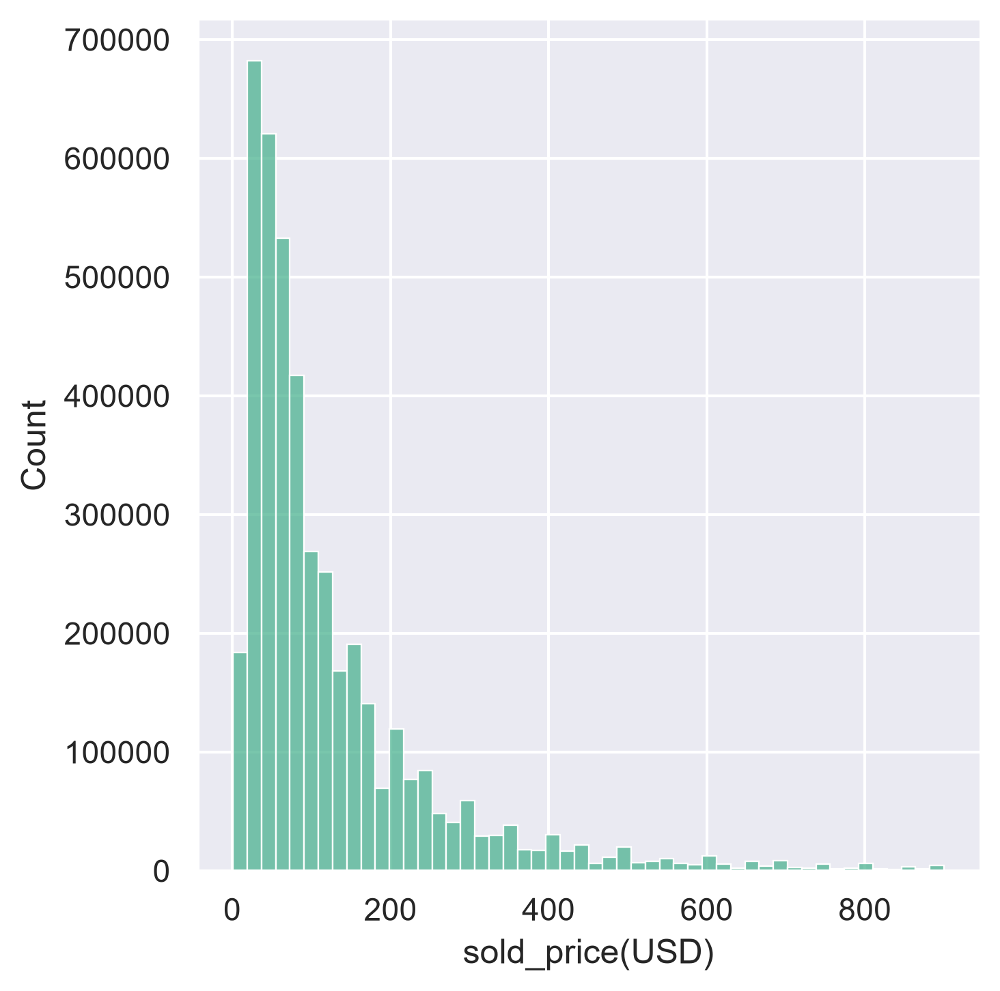
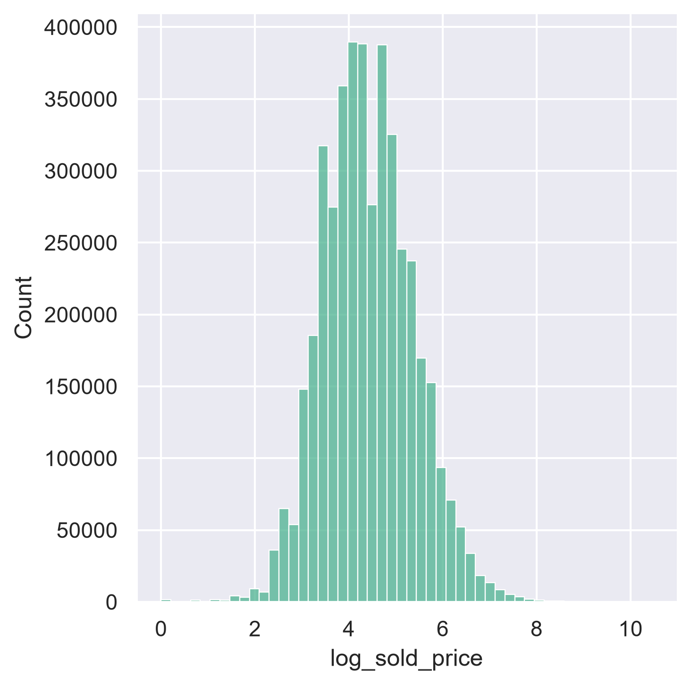
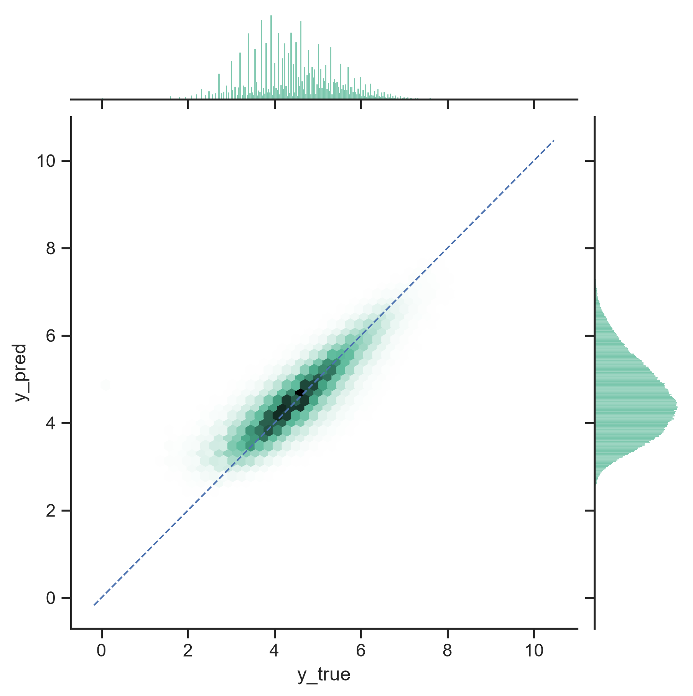

# GrailedDataAnalysis
# Price prediction for fashion resale on 4.3M scraped Grailed sold listings.
# 1. Rationale
  I buy and resell clothes regularly and wanted a better sense of what an item is actually worth before I price it.
# 2. Data
  4.35M sold listings scraped from Grailed covering Aug 2021 – Mar 2026, ~93% of Grailed's public sold index as of Sept. 2026. For the scraper I used Java, here is the [repo](https://github.com/mononoawaree/GrailedScraper.git)
# 3. Methodology
  The target is log(sold_price). Two reasons. Errors in resale pricing are multiplicative, not additive — being $50 off on a $100 item is a much worse mistake than being $50 off on a $1,000 item, but plain RMSE treats them identically.
  In log space both become the same distance. 
  Second, the price distribution is heavy-tailed (median $80, max $35,000), so squared error on raw dollars would be dominated by a few expensive listings.

 

  For the model I picked LightGBM - gradient boosting framework based on decision tree algorithms because features are mostly 
  heterogeneous, high-cardinality categoricals, so there is no need for scaling, and GBDTs remain the strongest baseline on tabular data neural alternatives mostly fail to beat them.
  LightGBM was tuned with these hyperparameters - 2000 estimators and 127 leaves, since vanilla ones were underfitting model substantially.
  For validation, I used 13 monthly walk-forward folds (train on everything before month N - test on N). 
  For leakage test check I used y-scramble and test performance collapsed to the constant baseline - RMSE(scramble) = 1.059 ~ RMSE(baseline) = 1.060

# 4. Results

13 monthly walk-forward folds. RMSE on log price; mean across folds.

| Model | RMSE | Within 20% |
|---|---|---|
| Constant | 1.060 | 17.1% |
| Designer × category mean | 0.712 | 25.2% |
| 11 structured features | 0.609 | 31.1% |
| + season/year parsed from titles | 0.603 | 31.4% |
| + TF-IDF titles | 0.532 | 35.2% |
| + FashionCLIP embeddings (PCA, 256 comps) | **0.520** | 36.0% |

Final model, per-fold range: 0.505–0.564. Repeated identical runs differ by
~0.0004 at n≈74k, so differences below ~0.001 are not meaningful.

# 5. Where it fails
# Error by price band

13 monthly walk-forward folds. Mean across folds, per-fold range in parentheses.

| Price band | RMSE | MAE | Within 20% | n / fold |
|---|---|---|---|---|
| < $50     | 0.621 (0.596–0.728) | 0.459 | 29.4% | 14,333–25,825 |
| $50–250   | 0.430 (0.423–0.439) | 0.331 | 39.7% | 32,346–42,661 |
| $250–800  | 0.537 (0.516–0.550) | 0.395 | 37.1% | 9,054–12,129 |
| > $800    | 0.853 (0.825–0.918) | 0.651 | 21.3% | 1,190–1,737 |
| **All**   | **0.520** (0.505–0.564) | 0.385 | 36.0% | 57,936–80,637 |

Error roughly doubles from the $50–250 band to $800+, and within-20% halves. Accuracy degrades at both ends of the price range, worst above $800 — where the model has the least data (~1,500 listings per fold) and prices depend most on factors the features don’t capture.

# Error by title frequency ($50–250 band only)

Title frequency = times the listing's exact title appeared in the training window.
Restricted to one price band so the effect isn't confounded with price.

| Title seen in train | RMSE | MAE | Within 20% | n / fold |
|---------------------|---|---|---|---|
| Never               | 0.447 (0.438–0.457) | 0.345 | 38.1% | 24,097–32,372 |
| Once                | 0.400 (0.390–0.408) | 0.310 | 41.8% | 3,041–4,051 |
| 10–100 times        | 0.352 (0.332–0.361) | 0.269 | 47.5% | 1,552–2,072 |

Band average: 0.430. Ranges do not overlap between adjacent rows in any of the 13 folds.
Title exposure drives error monotonically (0.447 → 0.400 → 0.352), but 74% of test listings have unseen titles and they’re only slightly worse — so the title features work through shared vocabulary, not memorization.

# 6. Noise floor

How much of the remaining error is reducible? Listings were grouped with their
nearest neighbours using FAISS (`IndexFlatIP` over L2-normalized FashionCLIP
embeddings) at cosine similarity ≥ 0.92, restricted to matching brand. The
standard deviation of log price within these near-duplicate groups is **0.332**.

Two listings that are visually near-identical and from the same brand are, to
any model built on images, titles and listing attributes, the same item — so
this variation is not predictable from the available features.
0.520² = 0.270 total
0.332² = 0.110 irreducible
**diff = √0.160 = 0.400** (Reducible conmp. in RMSE units)
Against that floor, roughly 41% of the model’s squared error is irreducible given these features; the remainder is potentially reducible.

# 7. What didn’t work
Four TF-IDF configurations spanning bigrams on/off and a 2× vocabulary range (30k, 60k, uncapped) differed by 0.0012 total on a single fold, with the two metrics disagreeing on direction. 
Against measured run-to-run variance of ~0.0004, the configurations are indistinguishable. max_features=15000 was kept because it is the cheapest to fit.
The title signal lives in high-frequency brand and collection tokens, and 74% of test titles are unseen anyway.

# 8. Limitations
Relists aren’t deduplicated. The same physical item sold twice — or relisted and sold once — appears as multiple rows, which inflates apparent title frequency and may leak between folds.
Selection bias. There are only listings that sold. Items listed and never sold aren’t in the data, so the model learns "what did this sell for, given that it sold." not "what could I get for this."
Single platform. Grailed-specific pricing, US-centric, one currency. Doesn’t transfer to other marketplaces without retraining.

# 9. Reproducing it